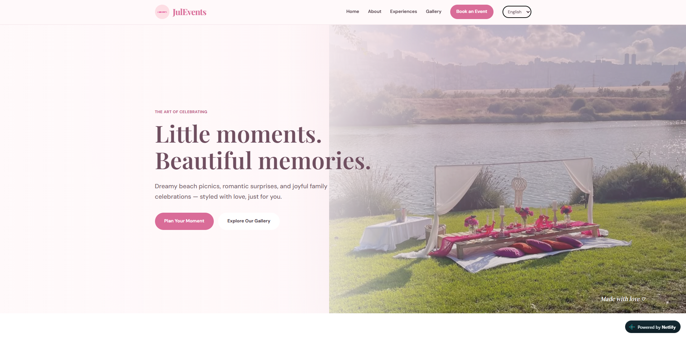
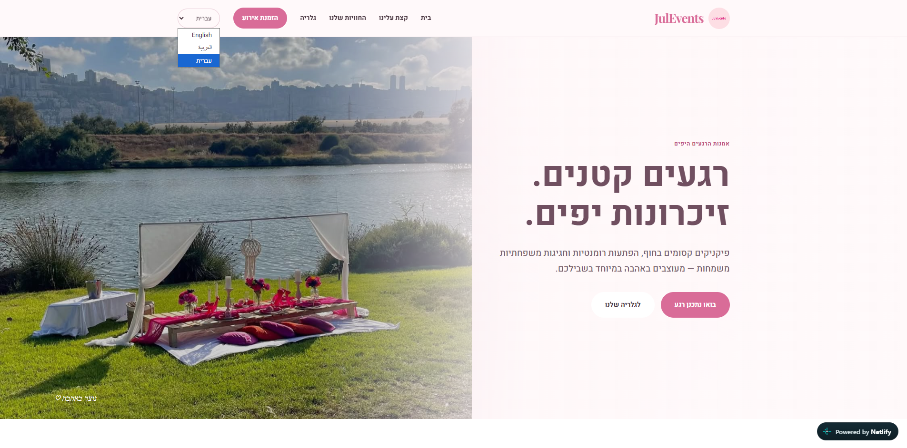
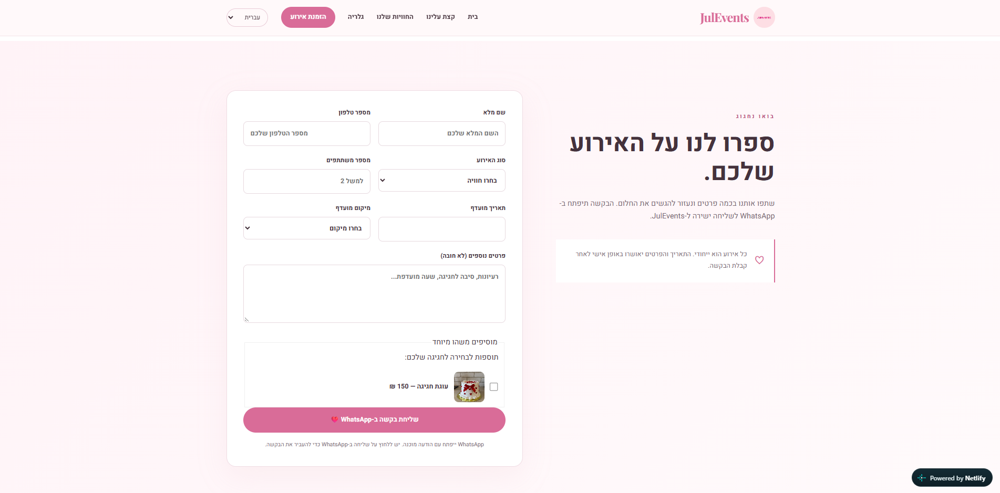

# JulEvents 🌸

A responsive, multilingual event-planning website showcasing thoughtfully styled celebrations, including romantic surprises, beach picnics, and family gatherings.

Built with **HTML, CSS, and vanilla JavaScript**, JulEvents provides a simple way for visitors to explore event experiences and send booking inquiries through WhatsApp.

**🌐 [View the Live Website](https://melodious-belekoy-7ff741.netlify.app/)**

## ✨ Features

- **Responsive design** — adapts to desktop, tablet, and mobile screens.
- **Multilingual interface** — English, Arabic, and Hebrew, with right-to-left support where appropriate.
- **Event experiences** — highlights different types of celebrations and setups.
- **Interactive photo gallery** — automatic image slider with previous/next arrows and navigation dots.
- **Booking inquiry form** — collects event details and opens WhatsApp with a prefilled message for the customer to send.
- **Single-page navigation** — easy access to the Home, About, Experiences, Gallery, and Booking sections.

## 🖼️ Screenshots

### Homepage — English



### Homepage — Arabic


### Homepage — Hebrew


### About Section



### Interactive Gallery


### Event Booking Form



## 🛠️ Tech Stack

- **HTML5** — page structure and content
- **CSS3** — styling, layout, and responsive design
- **JavaScript (ES6+)** — language switching, image slider, and booking form behavior
- **WhatsApp click-to-chat** — prefilled booking inquiries

## 🚀 Run Locally

1. Clone the repository:
   ```bash
   git clone https://github.com/Micheal3001/Julevent-website.git
   ```
2. Open the project folder in VS Code.
3. Open `index.html` in your browser, or use the **Live Server** extension in VS Code.

No build step or backend server is required.

## 📱 How Booking Works

Visitors fill out the booking inquiry form with their event information. When they submit it, the website opens WhatsApp with a prepared message containing those details. **The visitor must confirm and send the message in WhatsApp**; the website does not automatically submit or store bookings.

## 🌍 Supported Languages

- English
- Arabic (العربية)
- Hebrew (עברית)

## 🔗 Links

- **Live website:** [Visit JulEvents](https://melodious-belekoy-7ff741.netlify.app/)

---

*JulEvents — Little moments. Beautiful memories.*
